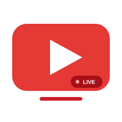

 
    
    <h1>YourTV</h1>

**Live news on your TV — free, simple, and familiar.**

No cable. No subscriptions. No login. Just the news.

---

YourTV turns the live news channels already on YouTube into a proper TV experience. It opens straight into a channel, changes channels with the remote, and remembers where you were — just like the TV you grew up with.

## ✨ Why you'll love it

- **It just plays.** Open the app and the news starts. No menus to dig through.
- **Feels like a real TV.** Channel numbers, Up/Down to change channels, and a channel list when you press OK.
- **Made for remotes.** Every action works with a standard TV remote — no mouse or keyboard needed.
- **Picks up where you left off.** Your last channel opens the next time you start the app.
- **Your favourites, front and centre.** Your most-watched channels appear on the Android TV home screen.
- **Gentle on slow internet.** If the connection struggles, the app tells you it's buffering and recovers on its own.
- **Saves data.** Set a bandwidth limit and watch on a metered or slow connection without burning through your plan.
- **Starts with the TV.** Optionally make YourTV open automatically when the TV turns on.

## 📺 Using it

Turn on the TV, open **YourTV**, and you're watching the news.

| Remote button | What it does |
| --- | --- |
| **Up / Down** | Next or previous channel |
| **OK** | Open the channel list |
| **Number keys** | Jump straight to a channel number |
| **Back** | Go back to the previous channel (press twice quickly to exit) |

A small resolution label in the bottom-right corner shows the current playback quality — handy when checking whether your connection is keeping up.

## 🎛️ Making it yours

Open the channel list and choose the **gear** to reach Settings.

| Setting | What it does |
| --- | --- |
| **Open when the TV starts** | Launches YourTV automatically when the TV boots. |
| **App resolution** | **Auto** by default. Choose a fixed resolution (down to 144p) to run the app at a smaller size — useful for older TVs or limited connections. |
| **Bandwidth limit** | **None** by default. Choose **250 kbps** up to **10 Mbps** to cap how much data streaming uses. Start low on slow connections and increase if playback stutters. |

Use **Left/Right** on the remote to change a setting, or press **OK** to step through the options.

## ⚠️ Good to know

- **An internet connection is required.** All channels are live YouTube streams.
- **Channels depend on the broadcaster.** If a channel isn't live at the moment, the app lets you know and moves on.
- **Built for Android TV 9 and newer.** It also works on other Android TV devices that run the same Android version.
- **You can make it your TV's home screen.** If your TV won't let you change the default launcher in its menus, this can usually be done with a few `adb` commands.
- **Stream quality is chosen by YouTube.** The app can lower the app's playback size and limit bandwidth, but YouTube always makes the final call on resolution.

---

Made for people who just want to watch the news.

